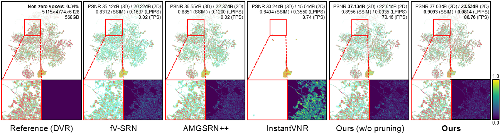
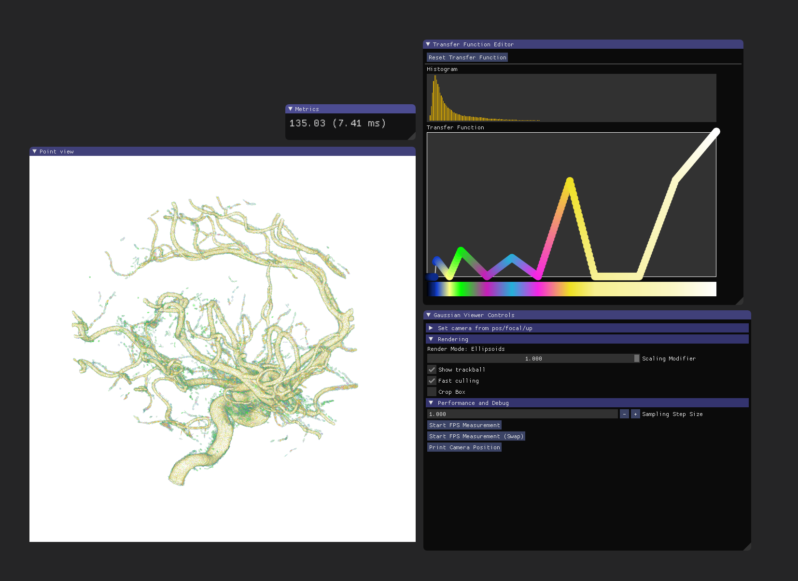

# ESVR: 3D Ellipsoid-based Sparse Volume Rendering via Structure-aware Primitive Learning and Per-primitive Ray Sampling



Suemin Jeon*, Youjin Kim*, Jungwoo Park, Kyungryun Lee, Won-Ki Jeong

\* Equal contribution

## Description

This repository contains the implementation of **ESVR: 3D Ellipsoid-based
Sparse Volume Rendering via Structure-aware Primitive Learning and
Per-primitive Ray Sampling**.

## Setup

Docker is recommended for a reproducible CUDA environment. 

### Tested Training Environment

Training and inference were tested with:

- **PyTorch:** `1.13.1+cu117`
- **NVCC:** `11.7`

### Installation

Clone the repository together with its submodules:

```bash
git clone --recursive https://github.com/hvcl/ESVR.git
cd ESVR
```

Build the Docker image and start an interactive container:

```bash
./docker/build.sh
./docker/use_docker.sh
```

To select a GPU and assign a container name, pass them as arguments:

```bash
./docker/use_docker.sh 0 esvr-container
```

Inside the container, install the Python dependencies and CUDA extensions:

```bash
export HOME=/tmp/esvr-home
mkdir -p "$HOME"

python -m pip install --user -r requirements.txt
python -m pip install --user ./submodules/simple-knn
python -m pip install --user ./submodules/gaussian-rasterization-voxelization
```

## Dataset

Dataset paths, volume dimensions, chunk sizes, and training modes are defined
in `dataset_configs.py`. An example Aneurysm volume is provided in `./data`.

Add a new entry to `DATASET_CONFIGS` before training on a custom volume.

## Training

### Single-volume and Sequential Chunk Training

Use `train_chunk.sh` for datasets configured with `training_mode: "full"` or
`training_mode: "chunk_sequential"`. The script trains all configured chunks
in sequence.

```bash
./train_chunk.sh aneurysm
```

If no dataset name is provided, the default dataset defined in the script is
used.

### Parallel Chunk Training

Use `train_parallel.sh` for datasets configured with
`training_mode: "chunk_parallel"`. Multiple chunks are assigned to the
available GPUs and trained in parallel.

```bash
./train_parallel.sh hemibrain_lLN2P
```

Set `BATCH_SIZE` in `train_parallel.sh` to control the number of chunks trained
at the same time. It should not exceed the number of available GPUs.

## Evaluation

Use `inference.py` to reconstruct a volume from a trained PLY file and evaluate
it against the ground-truth volume specified in `dataset_configs.py`.

Evaluate a trained point cloud and print the full-volume PSNR:

```bash
python inference.py \
  --dataset_name aneurysm \
  --input_ply ./output/point_cloud.ply
```

Add `--save_tif` to save the reconstructed volume as a TIFF file:

```bash
python inference.py \
  --dataset_name aneurysm \
  --input_ply ./output/point_cloud.ply \
  --save_tif \
  --output_tif ./output/aneurysm.tif \
  --output_dtype uint8 \
  --chunk_size 512
```

<details>
<summary>Command-line arguments for <code>inference.py</code></summary>

- `--dataset_name`: Dataset key defined in `dataset_configs.py`. Its volume
  dimensions and ground-truth path are used for reconstruction and evaluation.
- `--input_ply`: Path to the trained Gaussian point-cloud PLY file.
- `--save_tif`: Save the reconstructed volume as a TIFF file. If omitted, only
  evaluation is performed.
- `--output_tif`: Output TIFF path (default: `./output/volume_merged.tif`).
- `--output_dtype`: Output voxel type, either `uint8` or `uint16` (default:
  `uint8`).
- `--chunk_size`: Number of voxels queried along each axis per chunk (default:
  `1024`). Reduce this value if inference runs out of GPU memory.
- `--full`: Query the entire volume at once. This can be faster for small
  volumes but requires more GPU memory.

</details>

## Viewer



### Tested Build Environment

The Viewer was tested with:

- **Operating system:** Windows 10 (64-bit)
- **Visual Studio:** Visual Studio 2019 Community
- **MSVC compiler:** 19.29.30159 (x64)
- **MSVC toolset:** 14.29.30133 (v142)
- **Windows SDK:** 10.0.19041.0 / 10.0.26100.0
- **CMake:** 4.3.0
- **CUDA Toolkit / NVCC:** 11.8 / 11.8.89
- **NVIDIA driver:** 571.96
- **GPU:** NVIDIA GeForce RTX 3090 (24 GB)
- **Conda:** 25.11.1
- **Build configuration:** `RelWithDebInfo` (x64)

### Interactive GUI

A pre-built Viewer executable is included in `SIBR_viewer/install/bin`, so you
can run the Viewer directly without building it from source.

Launch the Viewer from the `SIBR_viewer/install/bin` directory and
specify the model output directory with `-m`:

```bash
cd SIBR_viewer/install/bin
SIBR_gaussianViewer_app_rwdi.exe -m <output_path>
```

Transfer Function Controls

- **Left-click** on the transfer function to add a control point at the cursor position.
- **Right-click** a control point to delete it.
- **Middle-click** a control point to change its color.


### Optional: Build from Source

If you want to build the Viewer yourself, configure and build it from the
`SIBR_viewer` directory:

```bash
cd SIBR_viewer
cmake -S . -B build
cmake --build build --target install --config RelWithDebInfo
```